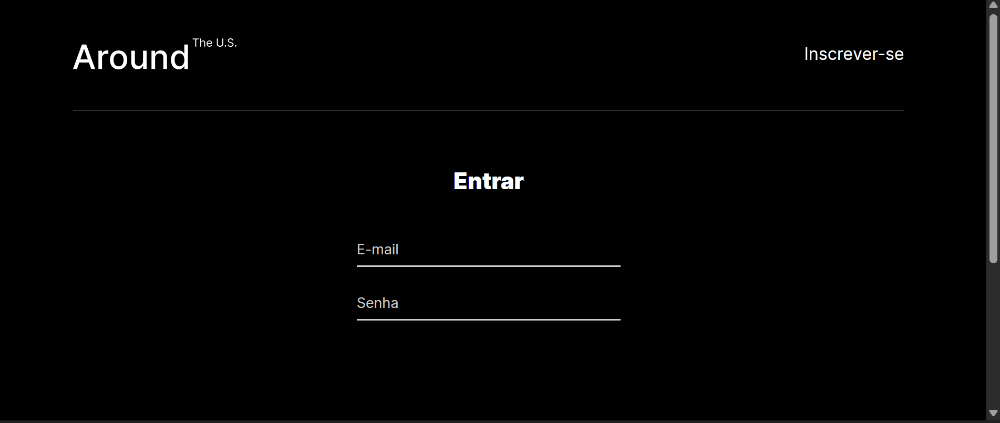
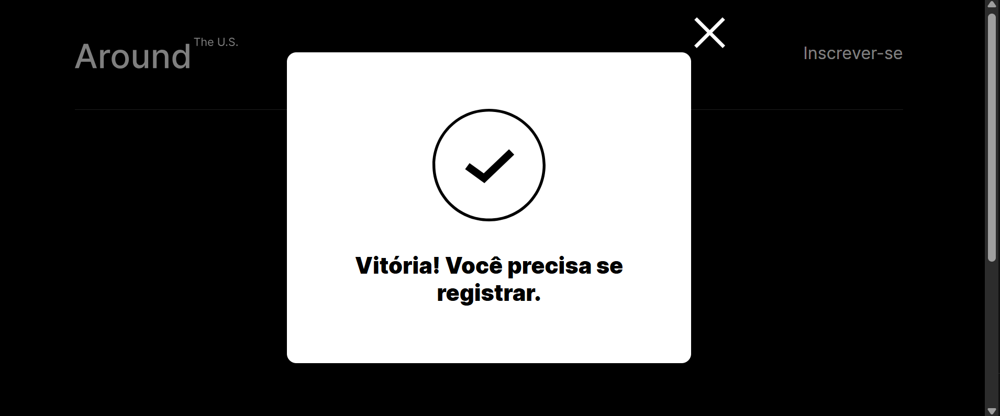

# Around the U.S. — Aplicativo Full Stack

Aplicativo web completo em que cada usuário cria uma conta, monta o próprio perfil e publica cartões com fotos de lugares, que podem ser curtidos por outros usuários. Este é o projeto final do curso de Desenvolvimento Web da TripleTen: o front-end em React, desenvolvido nos sprints anteriores, agora se comunica com uma API própria em Node.js, publicada em um servidor na nuvem.

## Links

- **Site:** https://around-rtuttmann.networkoutpost.com
- **API:** https://api.around-rtuttmann.networkoutpost.com

## Funcionalidades

- **Cadastro e login** com e-mail e senha; a senha é salva como hash (bcrypt) e nunca é devolvida pela API.
- **Autenticação por JWT**: o token, válido por 7 dias, é salvo no navegador e enviado no cabeçalho `Authorization` de cada requisição.
- **Rotas protegidas**: só usuários autenticados acessam a página principal e a API de usuários e cartões.
- **Edição de perfil** (nome e descrição) e **troca de avatar**.
- **Cartões**: adicionar, excluir (somente os próprios) e listar, dos mais novos para os mais antigos.
- **Curtidas**: curtir e descurtir cartões, uma curtida por usuário.

## Capturas de tela

| Login | Cadastro |
|---|---|
|  |  |

| Página principal | Mensagem de sucesso |
|---|---|
|  |  |

## API

| Método | Rota | Descrição | Token |
|---|---|---|---|
| POST | `/signup` | cadastra um usuário (`email`, `password`; `name`, `about`, `avatar` opcionais) | não |
| POST | `/signin` | faz login e devolve `{ token }` | não |
| GET | `/users` | lista os usuários | sim |
| GET | `/users/me` | dados do usuário atual | sim |
| GET | `/users/:userId` | dados de um usuário pelo `_id` | sim |
| PATCH | `/users/me` | atualiza `name` e `about` | sim |
| PATCH | `/users/me/avatar` | atualiza `avatar` | sim |
| GET | `/cards` | lista os cartões | sim |
| POST | `/cards` | cria um cartão (`name`, `link`) | sim |
| DELETE | `/cards/:cardId` | exclui um cartão (somente o dono) | sim |
| PUT | `/cards/:cardId/likes` | curte um cartão | sim |
| DELETE | `/cards/:cardId/likes` | remove a curtida | sim |

### Códigos de erro

Todas as respostas de erro têm apenas o campo `message`.

| Código | Quando |
|---|---|
| 400 | dados inválidos (validação com celebrate/Joi) ou `_id` em formato inválido |
| 401 | token ausente ou inválido; e-mail ou senha incorretos |
| 403 | tentativa de excluir o cartão de outro usuário |
| 404 | usuário, cartão ou rota inexistente |
| 409 | e-mail já cadastrado |
| 500 | erro inesperado — "Ocorreu um erro no servidor" |

## Tecnologias e técnicas

**Front-end**
- React 19 (componentes funcionais, hooks, Context API)
- React Router (rotas protegidas)
- Vite
- CSS com metodologia BEM

**Back-end**
- Node.js e Express
- MongoDB e Mongoose (esquemas, validadores, métodos estáticos)
- bcryptjs (hash de senhas) e jsonwebtoken (JWT)
- celebrate / Joi e validator (validação das requisições)
- Tratamento centralizado de erros com classes de erro personalizadas
- Winston e express-winston (logs em JSON: `request.log` e `error.log`)
- CORS e variáveis de ambiente com dotenv
- ESLint (padrão Airbnb)

**Servidor e implantação**
- Google Cloud Compute Engine (Ubuntu 22.04)
- NGINX como proxy reverso e servidor do front-end
- PM2 (mantém a API no ar e a reinicia em caso de falha)
- Certificados HTTPS do Let's Encrypt (Certbot), com renovação automática
- Domínio gratuito do FreeDNS

## Estrutura do repositório

```
├── backend/    API em Node.js / Express
├── frontend/   aplicativo em React
└── README.md
```

## Como rodar localmente

Pré-requisitos: Node.js e MongoDB rodando em `mongodb://localhost:27017`.

```bash
# back-end (porta 3000)
cd backend
npm install
npm run dev

# front-end (porta 5173), em outro terminal
cd frontend
npm install
npm run dev
```

Em desenvolvimento, o back-end funciona sem o arquivo `.env`. No servidor, o `.env` define `NODE_ENV=production` e a chave secreta `JWT_SECRET`.

## Autor

Ricardo Tuttmann
